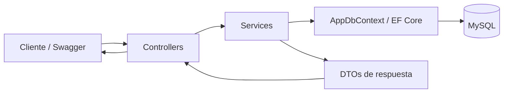
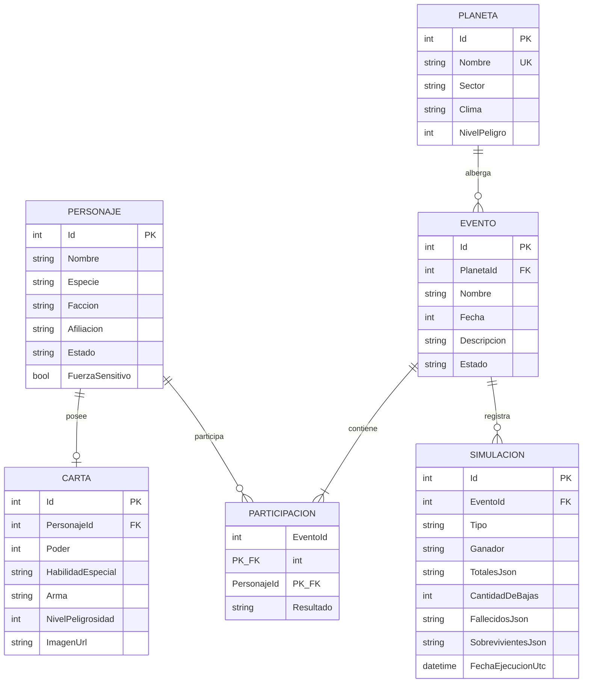

# Documentación técnica — Catálogo Galáctico

## 1. Objetivo del proyecto

Catálogo Galáctico es una API REST construida con ASP.NET Core Web API para administrar:

- personajes;
- cartas de poder;
- planetas;
- eventos;
- participaciones;
- simulaciones de batallas e invasiones;
- usuarios de demostración con datos protegidos.

El proyecto convierte una Minimal API en una solución organizada con controladores, DTOs, servicios, inyección de dependencias, Entity Framework Core y MySQL.

No implementa inicio de sesión ni JWT. La entidad `Usuario` existe únicamente para demostrar hash de contraseñas, cifrado de correo y detección segura de duplicados.

## 2. Tecnologías y dependencias

| Tecnología | Función |
|---|---|
| .NET 10 | Plataforma de ejecución |
| ASP.NET Core Web API | Rutas HTTP, controladores y respuestas JSON |
| Entity Framework Core 9 | Acceso a datos mediante entidades y LINQ |
| Pomelo.EntityFrameworkCore.MySql | Proveedor de EF Core para MySQL |
| MySQL 8.4.9 | Base de datos relacional |
| Microsoft.AspNetCore.Identity | Generación segura del hash de contraseñas |
| AES-GCM | Cifrado autenticado del correo electrónico |
| HMAC-SHA256 | Huella determinista para detectar correos duplicados |
| OpenAPI y Swagger UI | Documentación y prueba interactiva de endpoints |
| Secret Manager | Almacenamiento local de cadena de conexión y clave de cifrado |

Las referencias NuGet están declaradas en `CatalogoGalacticoWebApi.csproj`.

## 3. Arquitectura general

La aplicación usa una arquitectura por capas sencilla:



### Responsabilidad de cada capa

| Capa | Responsabilidad |
|---|---|
| Controllers | Recibir solicitudes HTTP, leer ruta/query/body y devolver códigos HTTP |
| Services | Ejecutar reglas de negocio, validaciones y operaciones de datos |
| DTOs | Definir contratos de entrada y salida sin exponer entidades sensibles |
| Models | Representar las tablas y relaciones de la base de datos |
| Data | Configurar Entity Framework Core y las relaciones |
| Migrations | Versionar los cambios del esquema MySQL |

El flujo normal de una solicitud es:

1. El cliente llama a una ruta `/api/...`.
2. El controlador recibe los parámetros o el JSON.
3. El controlador delega la operación a una interfaz de servicio.
4. El servicio valida las reglas de negocio.
5. El servicio consulta o modifica datos mediante `AppDbContext`.
6. El resultado vuelve al controlador dentro de `Resultado<T>`.
7. El controlador convierte el resultado en una respuesta HTTP JSON.

## 4. Estructura del proyecto

```text
CatalogoGalacticoGitHub/
├── Controllers/          Rutas HTTP de la API
├── Data/                 Contexto de Entity Framework
├── Dtos/                 Contratos de entrada y salida
├── Migrations/           Evolución del esquema MySQL
├── Models/               Entidades persistentes
├── Properties/           Perfil de ejecución local
├── Services/             Reglas de negocio y seguridad
├── Program.cs            Inicio y configuración de la aplicación
├── DOCUMENTACION_TECNICA.md Explicación integral del código y su arquitectura
├── GUIA_DE_ESTUDIO_DEL_CODIGO.md Recorrido didáctico archivo por archivo
├── PRUEBAS.http          Solicitudes manuales para probar la API
├── README.md             Instalación y uso rápido
├── KANBAN.md             Seguimiento de tareas
└── USO_DE_IA.md          Declaración del uso de IA
```

`bin/` y `obj/` son carpetas generadas por .NET. No contienen código fuente y están excluidas mediante `.gitignore`.

La carpeta `Endpoints/` no participa en la versión actual. Las rutas se implementan con controladores.

## 5. Inicio de la aplicación: `Program.cs`

`Program.cs` es el punto de entrada.

### Configuración principal

1. Crea el constructor de la aplicación con `WebApplication.CreateBuilder(args)`.
2. Configura el registro de eventos para mostrar información en consola.
3. Lee `ConnectionStrings:DefaultConnection` desde la configuración.
4. Registra `AppDbContext` con MySQL 8.4.9.
5. Registra controladores, OpenAPI y servicios.
6. Construye la aplicación.
7. Activa OpenAPI y Swagger únicamente en el ambiente `Development`.
8. Mapea los controladores y ejecuta el servidor.

### Inyección de dependencias

| Interfaz | Implementación | Tiempo de vida |
|---|---|---|
| `ICatalogoService` | `CatalogoService` | Scoped |
| `ISimulacionService` | `SimulacionService` | Scoped |
| `IUsuarioService` | `UsuarioService` | Scoped |
| `IPasswordHasher<Usuario>` | `PasswordHasher<Usuario>` | Scoped |
| `ICifradoService` | `CifradoService` | Singleton |

`Scoped` crea una instancia por solicitud HTTP. Es adecuado para servicios que usan `AppDbContext`. `CifradoService` es `Singleton` porque su clave se carga una vez y sus operaciones no guardan estado mutable.

La versión de MySQL se declara explícitamente para que las herramientas de EF Core no tengan que conectarse solamente para descubrirla al generar migraciones.

## 6. Modelo de datos y relaciones



### Relaciones configuradas

| Relación | Cardinalidad | Regla de eliminación |
|---|---|---|
| Personaje–Carta | 1 a 0..1 | Restrict |
| Planeta–Evento | 1 a N | Restrict |
| Personaje–Evento | N a M mediante Participación | Restrict para personaje |
| Evento–Participación | 1 a N | Cascade |
| Evento–Simulación | 1 a N | Restrict |

`Restrict` impide eliminar una entidad si otra todavía depende de ella. Por ejemplo, un planeta con eventos no se puede eliminar.

`Cascade` en Evento–Participación significa que, si se eliminara un evento desde EF, sus filas intermedias de participación también se borrarían.

## 7. Entidades de `Models/`

### 7.1 `Personaje`

Representa un personaje del catálogo.

| Propiedad | Descripción |
|---|---|
| `Id` | Clave primaria autoincremental |
| `Nombre` | Nombre del personaje |
| `Especie` | Especie de origen |
| `Faccion` | `Rebelde`, `Imperio` o `Neutral` |
| `Afiliacion` | Organización o grupo |
| `Estado` | `vivo`, `muerto` o `desconocido` |
| `FuerzaSensitivo` | Indica sensibilidad a la Fuerza |
| `Carta` | Navegación opcional 1:1 |
| `Participaciones` | Eventos en los que participa |

`Carta` y `Participaciones` tienen `[JsonIgnore]` para evitar ciclos de serialización y respuestas excesivamente grandes.

### 7.2 `Carta`

Almacena las características de combate de un personaje.

| Propiedad | Descripción |
|---|---|
| `PersonajeId` | Clave foránea; también tiene índice único |
| `Poder` | Valor entre 0 y 100 usado en simulaciones |
| `HabilidadEspecial` | Habilidad descriptiva |
| `Arma` | Arma principal |
| `NivelPeligrosidad` | Valor entre 1 y 10 |
| `ImagenUrl` | URL HTTP o HTTPS de imagen |

El índice único de `PersonajeId` garantiza que un personaje tenga como máximo una carta.

### 7.3 `Planeta`

Representa el lugar donde ocurre un evento.

| Propiedad | Descripción |
|---|---|
| `Nombre` | Nombre único del planeta |
| `Sector` | Sector galáctico, usado también como filtro |
| `Clima` | Descripción climática |
| `NivelPeligro` | Valor de 1 a 10 que afecta batallas |
| `Eventos` | Navegación 1:N |

### 7.4 `Evento`

Agrupa participantes, planeta y simulaciones.

| Propiedad | Descripción |
|---|---|
| `Fecha` | Año galáctico representado como entero |
| `PlanetaId` | Planeta donde ocurre |
| `Estado` | `pendiente` antes de simular y `simulado` después |
| `Participaciones` | Personajes asociados al evento |
| `Simulaciones` | Historial de ejecuciones |

Un evento que ya tiene simulaciones no se puede editar.

### 7.5 `Participacion`

Es la entidad intermedia de la relación N:M entre personajes y eventos.

Su clave primaria es compuesta: `EventoId + PersonajeId`. Esto evita agregar dos veces al mismo personaje al mismo evento.

`Resultado` puede ser:

- `pendiente`;
- `sobreviviente`;
- `fallecido`.

La propiedad calculada `Fallecido` no se guarda en la base porque tiene `[NotMapped]`. Solo facilita comprobaciones en C# y se ignora en JSON.

### 7.6 `Simulacion`

Guarda una fotografía histórica de una batalla.

| Propiedad | Descripción |
|---|---|
| `EventoId` | Evento simulado |
| `Tipo` | `batalla` o `invasion` |
| `Ganador` | Facción ganadora |
| `Criterio` | Explicación de las reglas aplicadas |
| `TotalesJson` | Poder base, factor y poder final de cada facción |
| `CantidadDeBajas` | Número de fallecidos de esa ejecución |
| `FallecidosJson` | IDs fallecidos en esa ejecución |
| `SobrevivientesJson` | IDs sobrevivientes en esa ejecución |
| `FechaEjecucionUtc` | Fecha UTC de la ejecución |

Los campos JSON permiten que cada simulación conserve su resultado aunque después se ejecuten nuevas simulaciones. No se reconstruye el pasado a partir del estado actual.

### 7.7 `Usuario`

Es una demostración de protección de datos.

| Propiedad | Contenido real |
|---|---|
| `Nombre` | Nombre visible |
| `CorreoBusquedaHash` | HMAC-SHA256 del correo normalizado |
| `CorreoCifrado` | Correo cifrado con AES-GCM |
| `PasswordHash` | Hash generado por ASP.NET Core Identity |

No existe una propiedad que guarde la contraseña en texto plano.

## 8. Contexto de datos: `AppDbContext`

`AppDbContext` hereda de `DbContext` y expone un `DbSet<T>` por cada tabla:

- `Personajes`;
- `Cartas`;
- `Planetas`;
- `Eventos`;
- `Participaciones`;
- `Simulaciones`;
- `Usuarios`.

`OnModelCreating` configura:

- campos obligatorios y longitudes máximas;
- índices únicos de planeta, carta y huella de correo;
- claves foráneas;
- clave primaria compuesta de participación;
- comportamiento de eliminación.

Las propiedades de navegación permiten usar `Include` y `ThenInclude` para cargar objetos relacionados.

`AsNoTracking()` se usa en consultas de solo lectura. Reduce el trabajo de EF Core porque no necesita vigilar cambios en esas entidades.

## 9. DTOs de entrada y salida

Los DTOs están en `Dtos/Inputs.cs` y se implementan como `record` porque son contratos de datos concisos e inmutables por intención.

### DTOs de entrada

| DTO | Uso | Validaciones destacadas |
|---|---|---|
| `PersonajeInput` | Crear/editar personaje | Campos obligatorios |
| `CartaInput` | Crear/editar carta | Poder 0–100, peligro 1–10 |
| `PlanetaInput` | Crear/editar planeta | Peligro 1–10 |
| `EventoInput` | Crear/editar evento | Participantes y estado pendiente |
| `InvasionInput` | Crear y simular invasión | Facciones atacante/defensora |
| `UsuarioInput` | Registrar usuario | Email válido, contraseña mínima de 8 |

Las anotaciones `[Required]`, `[Range]`, `[EmailAddress]` y `[MinLength]` son procesadas automáticamente por `[ApiController]`. Si el JSON no cumple, ASP.NET Core devuelve 400 antes de entrar al método del controlador.

### DTOs de salida

| DTO | Contenido |
|---|---|
| `UsuarioResponse` | ID, nombre y correo descifrado; nunca el hash |
| `RankingResponse` | Posición, personaje y poder |
| `TotalFaccionResponse` | Poder base, factor planetario y poder final |
| `ResultadoSimulacion` | Resultado completo de una ejecución |
| `PlanetaEventoResponse` | Resumen del planeta del evento |
| `ParticipanteEventoResponse` | Datos, estado, resultado y poder del participante |
| `EventoDetalleResponse` | Evento con planeta y participantes |

## 10. Resultado uniforme: `Resultado<T>`

`Resultado<T>` transporta desde los servicios:

- `Valor`: dato correcto;
- `Codigo`: código HTTP deseado;
- `Error`: mensaje cuando la operación falla.

Métodos auxiliares:

```csharp
Resultado<T>.Ok(dato, 200);
Resultado<T>.Fail("Mensaje", 400);
```

`ApiControllerBase.Enviar` traduce este objeto a `IActionResult`. De esta manera todos los controladores devuelven errores con la misma forma:

```json
{
  "error": "Descripción del problema"
}
```

## 11. Controladores y endpoints

Todos heredan de `ApiControllerBase`, por lo que reciben el comportamiento de `[ApiController]`.

### 11.1 Personajes

| Método | Ruta | Acción |
|---|---|---|
| GET | `/api/personajes` | Lista; filtra por `faccion` y `fuerzaSensitivo` |
| GET | `/api/personajes/{id}` | Devuelve uno |
| POST | `/api/personajes` | Crea |
| PUT | `/api/personajes/{id}` | Actualiza |
| DELETE | `/api/personajes/{id}` | Elimina si no tiene relaciones |
| GET | `/api/personajes/{id}/eventos` | Eventos del personaje |
| GET | `/api/personajes/ranking?por=poder` | Ranking por poder de carta |

Solo se acepta `por=poder`. Otro criterio devuelve 400.

### 11.2 Cartas

| Método | Ruta | Acción |
|---|---|---|
| GET | `/api/cartas` | Lista |
| GET | `/api/cartas/{id}` | Devuelve una |
| POST | `/api/cartas` | Crea para un personaje |
| PUT | `/api/cartas/{id}` | Actualiza |
| DELETE | `/api/cartas/{id}` | Elimina si no fue usada en simulación |

### 11.3 Planetas

| Método | Ruta | Acción |
|---|---|---|
| GET | `/api/planetas` | Lista; filtra por `sector` |
| GET | `/api/planetas/{id}` | Devuelve uno |
| POST | `/api/planetas` | Crea |
| PUT | `/api/planetas/{id}` | Actualiza |
| DELETE | `/api/planetas/{id}` | Elimina si no tiene eventos |
| GET | `/api/planetas/{id}/eventos` | Eventos del planeta |
| GET | `/api/planetas/actividad` | Ordena por cantidad de eventos |
| POST | `/api/planetas/{id}/simular-invasion` | Crea y simula una invasión |
| GET | `/api/planetas/{id}/estadisticas` | Resume eventos, batallas, bajas y victorias |

### 11.4 Eventos

| Método | Ruta | Acción |
|---|---|---|
| GET | `/api/eventos` | Lista |
| GET | `/api/eventos/{id}` | Detalle con planeta y participantes |
| POST | `/api/eventos` | Crea con participantes |
| PUT | `/api/eventos/{id}` | Edita solo si no fue simulado |
| GET | `/api/eventos/{id}/mvp` | Participante con mayor poder |
| POST | `/api/eventos/{id}/simular` | Ejecuta batalla |
| GET | `/api/eventos/{id}/resultado` | Último resultado |
| GET | `/api/eventos/{id}/historial` | Todas las simulaciones |

### 11.5 Usuarios

| Método | Ruta | Acción |
|---|---|---|
| POST | `/api/usuarios` | Registra usuario protegido |
| GET | `/api/usuarios/{id}` | Devuelve correo descifrado sin contraseña |

## 12. `CatalogoService`

Centraliza el CRUD y las consultas del catálogo.

### Reglas de personajes

- Facciones válidas: `Rebelde`, `Imperio`, `Neutral`.
- Estados válidos: `vivo`, `muerto`, `desconocido`.
- Los textos se limpian con `Trim()`.
- La comparación de opciones ignora mayúsculas/minúsculas.
- Un personaje muerto no puede volver a otro estado.
- Un personaje con carta o participaciones no se puede eliminar.

### Ranking

Carga cartas con su personaje, ordena por poder descendente y después por nombre. Finalmente asigna las posiciones empezando en 1.

### Reglas de cartas

- El personaje debe existir.
- Solo puede tener una carta.
- Poder entre 0 y 100.
- Nivel de peligrosidad entre 1 y 10.
- Arma y habilidad son obligatorias.
- La imagen debe ser una URL absoluta HTTP/HTTPS.
- Una carta utilizada en un evento simulado no se puede modificar ni eliminar.

### Reglas de planetas

- Nombre, sector y clima obligatorios.
- Nivel de peligro entre 1 y 10.
- El nombre es único.
- Un planeta con eventos devuelve 409 al intentar eliminarlo.

### Reglas de eventos

- Nombre y descripción obligatorios.
- El planeta debe existir.
- El estado de un evento nuevo/editable debe ser `pendiente`.
- Se necesitan al menos dos participantes distintos.
- Todos los IDs deben existir.
- No se aceptan personajes muertos.
- Deben existir al menos dos facciones.
- Después de la primera simulación no se permite editar el evento.

`EventoDetalle` usa una proyección LINQ. Devuelve únicamente la información necesaria y evita ciclos de navegación.

## 13. `SimulacionService`

Es la parte principal de la lógica de batalla.

### 13.1 Requisitos para simular

1. El evento debe existir.
2. Solo se toman participaciones cuyo resultado no sea `fallecido`.
3. El personaje debe tener estado `vivo`.
4. Todos los participantes disponibles deben tener carta.
5. Deben quedar exactamente dos facciones.

### 13.2 Selección de la facción defensora

- En una invasión se utiliza `FaccionDefensora` enviada en el JSON.
- En una batalla normal se usa la facción del participante vivo con menor ID.

Esta segunda regla hace que la elección sea determinista: con los mismos datos siempre se obtiene el mismo defensor.

### 13.3 Cálculo de poder

Poder base:

```text
poderBase = suma del Poder de todas las cartas de la facción
```

Factor defensor:

```text
factor = 1 + nivelPeligro × 0.05
```

Como `nivelPeligro` está entre 1 y 10, la bonificación está entre 5% y 50%.

Poder final:

```text
poderFinal = poderBase × factor
```

La facción atacante usa factor `1.0`.

### 13.4 Ganador y desempate

El orden usado es:

1. mayor poder final;
2. mayor poder base;
3. nombre de facción en orden alfabético.

Esto elimina resultados ambiguos y cumple la necesidad de un desempate reproducible.

### 13.5 Fórmula de bajas

Primero se calcula la proporción del poder ganador:

```text
proporcionPoder = poderGanador / (poderGanador + poderPerdedor)
```

Si ambos poderes son cero, se usa `0.5` para evitar división entre cero.

Después:

```text
tasaBajas = mínimo(
    1.0,
    0.25 + 0.50 × proporcionPoder + 0.025 × nivelPeligro
)

cantidadBajas = máximo(
    1,
    techo(cantidadPerdedores × tasaBajas)
)
```

El peligro modifica tanto el poder defensor como las bajas. Los fallecidos se eligen entre la facción perdedora, primero por menor poder de carta y después por menor ID.

### 13.6 Actualización atómica

En una sola transacción se actualiza:

- `Participacion.Resultado`;
- `Personaje.Estado` para fallecidos;
- `Evento.Estado` a `simulado`;
- una nueva fila de `Simulacion`.

Si `SaveChangesAsync` o el commit falla, se ejecuta rollback. Así no puede guardarse una simulación sin sus bajas o dejar personajes muertos sin resultado histórico.

### 13.7 Historial

Cada simulación guarda sus propios JSON de poder, fallecidos y sobrevivientes. `Resultado()` devuelve la última por fecha e ID. `Historial()` devuelve todas en orden descendente.

Una segunda simulación solo utiliza personajes todavía vivos. Las bajas anteriores no se sobrescriben.

### 13.8 Invasión

`Invadir` ejecuta dos acciones dentro de una transacción exterior:

1. crea el evento;
2. lo simula con la facción defensora indicada.

Si la simulación falla, también se revierte la creación del evento. Esto evita eventos incompletos.

### 13.9 Estadísticas

Para un planeta devuelve:

- total de eventos;
- total de simulaciones;
- suma de bajas históricas;
- victorias agrupadas por facción.

## 14. Seguridad de usuarios

### 14.1 Normalización del correo

Antes de guardarlo:

```text
correo = Trim().ToLowerInvariant()
```

Esto hace que `USUARIO@MAIL.COM` y `usuario@mail.com` se consideren el mismo correo.

### 14.2 Huella HMAC-SHA256

`HuellaCorreo` calcula una huella usando la clave secreta. Es determinista, por lo que permite buscar duplicados, pero no guarda el correo en claro.

El campo tiene índice único en MySQL. La aplicación valida primero y la base de datos también protege la unicidad.

### 14.3 Cifrado AES-GCM

`CifradoService` exige una clave Base64 que represente exactamente 32 bytes, es decir, AES-256.

Para cada cifrado genera:

- nonce aleatorio de 12 bytes;
- etiqueta de autenticación de 16 bytes;
- texto cifrado.

Se almacena en Base64 con este orden:

```text
nonce (12) + tag (16) + datos cifrados
```

AES-GCM garantiza confidencialidad e integridad. Si los datos o la etiqueta cambian, el descifrado falla.

### 14.4 Hash de contraseña

`PasswordHasher<Usuario>` de ASP.NET Core Identity genera el hash. No es cifrado reversible y no utiliza la misma función que el correo.

La API nunca devuelve:

- `PasswordHash`;
- `CorreoBusquedaHash`;
- `CorreoCifrado`.

`UsuarioResponse` contiene solo ID, nombre y correo descifrado.

## 15. Códigos HTTP utilizados

| Código | Significado en el proyecto |
|---|---|
| 200 | Consulta o actualización correcta |
| 201 | Recurso creado |
| 204 | Eliminación correcta sin cuerpo |
| 400 | JSON o regla de negocio inválida |
| 404 | Recurso inexistente |
| 409 | Conflicto: duplicado, relación o estado incompatible |

## 16. Migraciones de Entity Framework

| Migración | Propósito |
|---|---|
| `Inicial` | Crea personajes, cartas, planetas, eventos, participaciones y usuarios |
| `AgregarSimulaciones` | Crea la tabla de simulaciones inicialmente 1:1 |
| `ConvertirSimulacionEnHistorial` | Cambia el índice para permitir Evento 1:N Simulaciones |
| `SincronizarModelo` | Sincroniza metadata `AUTO_INCREMENT` del snapshot |
| `CompletarPropuesta` | Agrega estado del evento y snapshot de bajas/sobrevivientes |
| `ResultadoDeParticipacion` | Cambia el booleano antiguo por `pendiente/sobreviviente/fallecido` |

Cada migración tiene:

- `Up`: aplica el cambio;
- `Down`: revierte el cambio.

Los archivos `.Designer.cs` contienen metadata generada por EF Core. `AppDbContextModelSnapshot.cs` representa el modelo final esperado. Normalmente no se editan manualmente.

Comandos importantes:

```powershell
dotnet ef migrations list
dotnet ef database update
dotnet ef migrations has-pending-model-changes
```

## 17. Configuración y secretos

`appsettings.json` contiene únicamente configuración pública de logs y hosts. Los secretos no se guardan allí.

La cadena y la clave se configuran en la carpeta del `.csproj`:

```powershell
dotnet user-secrets set "ConnectionStrings:DefaultConnection" "server=localhost;port=3306;database=catalogo_galactico;user=USUARIO_FICTICIO;password=CLAVE_FICTICIA;SslMode=None"

$bytes = New-Object byte[] 32
$rng = [System.Security.Cryptography.RandomNumberGenerator]::Create()
$rng.GetBytes($bytes)
dotnet user-secrets set "Cifrado:Clave" ([Convert]::ToBase64String($bytes))
$rng.Dispose()
Remove-Variable bytes,rng
```

`SslMode=None` se usa solamente para el servidor MySQL local configurado en este proyecto.

`.gitignore` excluye archivos comunes que podrían contener configuración local o secretos:

- `.env`;
- `.env.*`;
- `appsettings.Local.json`;
- `secrets.json`;
- `.vscode/`;
- `bin/` y `obj/`.

## 18. Ejecución

Desde la carpeta del proyecto:

```powershell
dotnet restore
dotnet build
dotnet ef database update
dotnet run --launch-profile http
```

Direcciones locales:

- API: `http://localhost:5080`;
- Swagger: `http://localhost:5080/swagger`;
- OpenAPI: `http://localhost:5080/openapi/v1.json`.

`Properties/launchSettings.json` establece el puerto 5080, abre Swagger y usa el ambiente `Development`.

## 19. Pruebas con `PRUEBAS.http`

El archivo puede ejecutarse con la extensión REST Client de VS Code. Contiene ejemplos para:

- crear y actualizar recursos;
- validar duplicados con 409;
- consultar ranking y filtros;
- crear y simular eventos;
- consultar último resultado e historial;
- probar invasiones y estadísticas;
- crear usuarios y comprobar que no se exponen hashes.

Los IDs de la cabecera deben ajustarse a los registros existentes en la base local.

## 20. Ejemplo completo de batalla

### Crear evento

```http
POST /api/eventos
Content-Type: application/json

{
  "nombre": "Batalla de ejemplo",
  "fecha": 2026,
  "descripcion": "Prueba documentada",
  "planetaId": 1,
  "participanteIds": [1, 2],
  "estado": "pendiente"
}
```

### Simular

```http
POST /api/eventos/1/simular
```

### Respuesta conceptual

```json
{
  "eventoId": 1,
  "tipo": "batalla",
  "ganador": "Imperio",
  "criterio": "Defensor: ...",
  "totales": [
    {
      "faccion": "Imperio",
      "poderBase": 100,
      "factor": 1.3,
      "poderFinal": 130
    }
  ],
  "cantidadDeBajas": 1,
  "fallecidoIds": [1],
  "sobrevivienteIds": [2],
  "fechaEjecucionUtc": "2026-11-09T23:00:00Z"
}
```

## 21. Decisiones importantes de diseño

### ¿Por qué controladores?

Separan las rutas HTTP de la lógica de negocio y siguen la estructura solicitada para ASP.NET Core Web API.

### ¿Por qué interfaces de servicios?

Reducen el acoplamiento, facilitan reemplazar implementaciones y permiten pruebas unitarias futuras.

### ¿Por qué DTOs?

Evitan recibir o devolver directamente entidades completas, controlan la forma del JSON y protegen campos sensibles.

### ¿Por qué guardar snapshots JSON en simulaciones?

Porque el estado de personajes y participaciones cambia. Si el historial se reconstruyera con datos actuales, todas las simulaciones mostrarían las mismas bajas.

### ¿Por qué transacciones?

Una simulación modifica varias tablas. La transacción garantiza que se guarden todas las modificaciones o ninguna.

### ¿Por qué HMAC además del cifrado?

El cifrado AES-GCM usa un nonce aleatorio, por lo que el mismo correo produce textos cifrados diferentes. No sirve para buscar duplicados directamente. La huella HMAC es determinista y permite esa búsqueda sin guardar el correo claro.

### ¿Por qué `[JsonIgnore]`?

Las propiedades de navegación se referencian en ambas direcciones. Ignorarlas evita ciclos como Personaje → Participación → Personaje.

## 22. Preguntas rápidas para la defensa

### ¿Dónde están las reglas de negocio?

En `CatalogoService`, `SimulacionService` y `UsuarioService`. Los controladores solo coordinan HTTP.

### ¿Cómo se implementa N:M?

Con `Participacion`, cuya clave compuesta es `EventoId + PersonajeId`.

### ¿Cómo se garantiza una carta por personaje?

Con la relación 1:1 y un índice único sobre `Carta.PersonajeId`.

### ¿Cómo evita inconsistencias una simulación?

Usa una transacción que guarda evento, participaciones, personajes y simulación de forma atómica.

### ¿Cómo conserva el historial?

Cada fila de `Simulacion` guarda sus propios totales, fallecidos y sobrevivientes serializados.

### ¿La contraseña se puede descifrar?

No. Se almacena como hash. El correo sí se puede descifrar porque el endpoint de consulta debe mostrarlo.

### ¿Dónde se guardan los secretos?

En Secret Manager del equipo local, fuera del repositorio.

### ¿Qué impide eliminar un planeta usado?

La validación de servicio y la clave foránea configurada con `DeleteBehavior.Restrict`.

## 23. Inventario archivo por archivo

| Archivo | Función |
|---|---|
| `Program.cs` | Configuración, DI, middleware y arranque |
| `CatalogoGalacticoWebApi.csproj` | Framework y paquetes NuGet |
| `Data/AppDbContext.cs` | Tablas, claves, índices y relaciones |
| `Dtos/Inputs.cs` | Todos los contratos JSON |
| `Models/Personaje.cs` | Entidad personaje |
| `Models/Carta.cs` | Entidad carta |
| `Models/Planeta.cs` | Entidad planeta |
| `Models/Evento.cs` | Entidad evento |
| `Models/Participacion.cs` | Unión N:M y resultado |
| `Models/Simulacion.cs` | Snapshot histórico de batalla |
| `Models/Usuario.cs` | Usuario protegido |
| `Controllers/ApiControllerBase.cs` | Conversión uniforme de resultados |
| `Controllers/PersonajesController.cs` | Rutas de personajes y ranking |
| `Controllers/CartasController.cs` | Rutas de cartas |
| `Controllers/PlanetasController.cs` | Rutas de planetas e invasiones |
| `Controllers/EventosController.cs` | Rutas de eventos y batallas |
| `Controllers/UsuariosController.cs` | Registro y consulta segura |
| `Services/Resultado.cs` | Resultado genérico de servicios |
| `Services/ICatalogoService.cs` | Contrato del catálogo |
| `Services/CatalogoService.cs` | CRUD y reglas del catálogo |
| `Services/ISimulacionService.cs` | Contrato de simulación |
| `Services/SimulacionService.cs` | Batallas, invasiones e historial |
| `Services/IUsuarioService.cs` | Contrato de usuarios |
| `Services/UsuarioService.cs` | Registro y consulta de usuarios |
| `Services/ICifradoService.cs` | Contrato criptográfico |
| `Services/CifradoService.cs` | AES-GCM y HMAC-SHA256 |
| `Migrations/*.cs` | Cambios versionados del esquema |
| `Migrations/*.Designer.cs` | Metadata generada de cada migración |
| `Migrations/AppDbContextModelSnapshot.cs` | Modelo final conocido por EF Core |
| `Properties/launchSettings.json` | Perfil HTTP y Swagger local |
| `appsettings.json` | Configuración pública |
| `.editorconfig` | Estilo de código del proyecto |
| `.gitignore` | Archivos que Git no debe subir |
| `DOCUMENTACION_TECNICA.md` | Arquitectura, entidades, rutas, reglas y operación del sistema |
| `GUIA_DE_ESTUDIO_DEL_CODIGO.md` | Explicación didáctica de sintaxis, archivos y flujo del código |
| `PRUEBAS.http` | Casos de prueba manuales |
| `README.md` | Guía rápida de instalación |
| `KANBAN.md` | Estado de tareas |
| `USO_DE_IA.md` | Transparencia sobre asistencia de IA |

## 24. Alcance y posibles mejoras futuras

El alcance actual cumple la propuesta académica. Mejoras que podrían implementarse después, pero no son necesarias para esta entrega:

- pruebas unitarias con xUnit;
- paginación de listados;
- autenticación y autorización con JWT;
- enums para facción y estados;
- normalizar snapshots de simulación en tablas adicionales;
- controlador global de excepciones;
- logging estructurado y métricas;
- despliegue con Docker.

Estas mejoras no deben confundirse con errores pendientes: corresponden a una posible evolución del sistema.
